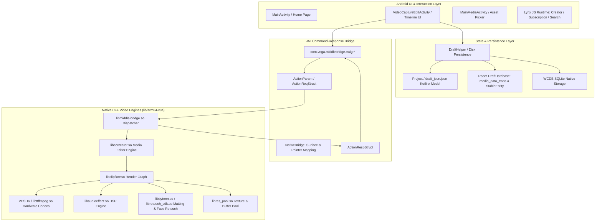

# Blueprint 01: Master Architecture and Feature Map

**Target Artifact:** `./target-artifacts/capcut.apk`  
**Derived From:** `CapCut_19.8.0.apks` (Split bundle merged: `base.apk` + `split_config.arm64_v8a.apk`)  
**Package Name:** `com.lemon.lvoverseas`  
**Target Architecture:** Android ARM64 (`arm64-v8a`)  
**Investigation Framework:** Static Android Reverse Engineering & REA Static Contract Protocol  

---

## 1. Observed Facts (Static Evidence)

### 1.1 Artifact Hashes & Physical Attributes
- **Target File Path:** `/storage/emulated/0/ApkLab/CapCutREA/target-artifacts/capcut.apk`
- **Bundle File Path:** `/storage/emulated/0/ApkLab/CapCutREA/CapCut_19.8.0.apks`
- **SHA-256 (`capcut.apk`):** `7f0df3c51b243dc7c4c982fc18bdf2c310a2d3814fb009a5870945383cc7d4fe`
- **SHA-256 (`CapCut_19.8.0.apks`):** `9f74a645b9d200fd9606e4dc3ffd91ec32701042e12fd2c691bc9be590ff115c`
- **File Size:** `202,729,369 bytes` (~193.34 MiB)
- **Magic Bytes:** `50 4B 03 04` (`PK\x03\x04` - Zip archive / Android Package format)
- **File System Stat:**
  - Inode: `3042564`
  - Mode: `0100660 (-rw-rw----)`
  - Blocks: `396352` (IO Block: 4096)
- **REA Evidence IDs:**
  - Artifact Graph View: `ev_2e04e9dd204d736b15be669c453158e5b74c19fe61fef9f42d8dbca0bc1e7d66`
  - Artifact Signature View: `ev_b4906d74012bc4ca8f06e53c3dcb28d217b10700f04c919c6a81076a4154713c`
  - Parent Manifest Evidence: `ev_cbcb066d1347e34c91d6f4b3a821b8d847a71e4cc38b7e174fa8e079b8b6bb2d`
  - V1 Signer Certificate Fingerprint (SHA-256): `6f33fd446f6e83a767d4fff9c19cecf76059814ea6a7ea71df1d0def2d75db31`

### 1.2 Archive Structural Inventory
- **Total Cataloged Entries:** `18,731 files`
  - **DEX Bytecode Files:** `36 files` (`classes.dex` through `classes35.dex`, total ~308 MiB uncompressed bytecode)
  - **Native Shared Libraries (`.so`):** `164 files` (161 Standard ELF64 libraries, 1 ByteDance Komprese-packed binary `libcapcut.so`, 2 OFX assets)
  - **Asset Files (`assets/`):** `1,072 files`
    - `.json` data/template descriptors: `673 files`
    - `.png` bitmap textures: `169 files`
    - `.zip` resource bundles: `115 files`
    - `.ttf` vector typefaces: `47 files`
    - `.js` Lynx UI modules: `25 files`
    - `.model` ByteDance neural network models: `2 files` (`js_clip128_v1.0.model`, `js_translation_v1.0.model`)
    - OFX smart crop binaries: `2 files` (`assets/smart_crop/smart_cut.ofx.so-32`, `assets/smart_crop/smart_cut.ofx.so-64`)
  - **Resource Files (`res/`):** `16,298 files`
  - **Meta / Configuration Files:** `1,163 files`

### 1.3 AndroidManifest & Application Metadata
- **Decoded Manifest Path:** `./scratch/capcut-decompiled/apktool-out/AndroidManifest.xml`
- **Application ID:** `com.lemon.lvoverseas`
- **Compile SDK Version:** `36` (Android 16 preview platform)
- **Primary Launcher Activity:** `com.vega.main.MainActivity`
- **Editing Host Activity:** `com.vega.edit.videocapture.VideoCaptureEditActivity` / `com.vega.edit.video.editor.EditorActivity`
- **Template Engine Activity:** `com.vega.edward.templatecore.editor.edit.MinimalEditorActivity`
- **Media Gallery Activity:** `com.vega.gallery.main.MainMediaActivity`
- **Background Optimization Service:** `com.vega.launcher.start.task.BackgroundMemoryRestartService` (`:memopt` isolated process)

### 1.4 Native Core Engine Binaries (`lib/arm64-v8a/`)
All native media binaries target AArch64 (ELF64 Little Endian, Machine: ARM AArch64 [183]):
- `libmiddle-bridge.so` (62,139,168 bytes): Master cross-platform editing bridge (SWIG JNI facade linking Java/Kotlin to C++ core).
  - Dynamic dependencies (`DT_NEEDED`): `libmiddleware.so`, `libclipflow.so`, `libcccreator.so`, `libjnigraphics.so`, `libEGL.so`, `libandroid.so`, `libc++_shared.so`.
  - Total Exported Symbols in `.dynsym`: 87,559 symbols.
  - Exported JNI Symbols (`Java_com_vega_middlebridge_swig_*`): **49,115 functions**.
- `libcccreator.so` (40,204,736 bytes): CapCut Creator Native Core Engine (graph execution, composite rendering, timeline model, clip tracking).
- `libmiddleware.so` (24,908,280 bytes): ByteDance Video Architecture Middleware.
- `libres_pool.so` (9,925,624 bytes): Native decoded frame buffer & hardware texture cache manager.
- `libttffmpeg.so` (5,771,392 bytes): ByteDance customized FFmpeg media demuxer/decoder engine.
- `libaudioeffect.so` (5,083,304 bytes): Digital signal processing (DSP) suite: time-stretching, pitch-shifting, audio equalization, reverb, voice changer, AI noise reduction.
- `libclipflow.so` (4,934,144 bytes): Clip flow execution graph & multithreaded render pipeline.
- `liblynx.so` (4,063,264 bytes) & `libkrypton.so` (1,739,904 bytes): Lynx native layout and canvas UI engine.
- `libbytenn.so` (3,131,416 bytes): ByteNN on-device neural network inference engine (face tracking, matting, auto-beat detection).
- `libskity.so` (1,427,736 bytes): ByteDance Skity 2D vector rendering engine (Skia alternative).
- `libwcdb.so` (1,763,776 bytes): Tencent WCDB encrypted high-performance SQLite engine.

---

## 2. Derived Architectural Conclusions

### 2.1 High-Level Architectural Diagram



---

### 2.2 Package Namespace Architecture Map

| Subsystem Domain | DEX Slices | Key Package Namespaces | Core Classes & Interfaces |
| :--- | :--- | :--- | :--- |
| **Timeline UI & Editing** | `classes12.dex`, `classes13.dex`, `classes23.dex` | `com.vega.edit` | `VideoCaptureEditActivity`, `EditorActivity`, `EditViewModel`, `TrackView`, `ClipTimelineAdapter` |
| **Draft Persistence** | `classes8.dex`, `classes28.dex`, `classes31.dex` | `com.vega.draft`, `com.vega.draft.data.template` | `Project`, `DraftHelper`, `DraftJsonGlobalGuard`, `BaseDraftDiskHelper`, `Materials`, `Track`, `Segment` |
| **Media Engine SWIG Bridge** | `classes13.dex`, `classes14.dex`, `classes24.dex`, `classes26.dex`, `classes34.dex` | `com.vega.middlebridge.swig` | `NativeBridge`, `ActionParam`, `AddCommonKeyframeModuleJNI`, `AddVideoTransitionModuleJNI`, `AdjustCanvasSizeModuleJNI`, `UpdateVideoSpeedModuleJNI` |
| **VESDK Engine (Low-Level)** | `classes9.dex`, `classes26.dex`, `classes32.dex` | `com.ss.android.vesdk` | `VESDK`, `TERecorder`, `VEVideoEncodeSettings`, `VEEffect`, `VEAudioCapture`, `VEConfigCenter`, `clipparam.*`, `filterparam.*` |
| **Audio & DSP Suite** | `classes9.dex`, `classes12.dex`, `classes17.dex` | `com.vega.audio`, `com.vega.draft.data.template.material` | `MaterialAudio`, `MaterialBeat`, `MaterialAudioFade`, `MaterialAudioBalance`, `ToneDebugActivity` |
| **Text, Subtitles & Fonts** | `classes10.dex`, `classes22.dex`, `classes24.dex` | `com.vega.text`, `com.vega.draft.data.template.material` | `MaterialText`, `MaterialTextTemplate`, `TextInfoResource`, `TypePathInfo`, `ShadowPoint` |
| **Keyframes & Curves** | `classes17.dex`, `classes28.dex`, `classes31.dex` | `com.vega.draft.data.template.keyframes` | `KeyFrames`, `VideoKeyFrame`, `AudioKeyFrame`, `TextKeyFrame`, `GraphParam`, `GraphPoint`, `CurveSpeedData`, `CurvePoint` |
| **Export & Transcode** | `classes8.dex`, `classes22.dex` | `com.vega.export`, `com.ss.android.vesdk` | `ExportActivity`, `VEVideoEncodeSettings`, `MediaDataTransDao`, `MediaDataTransEntity` |
| **Dynamic UI (Lynx)** | `classes3.dex`, `assets/offline/` | `com.bytedance.lynx`, `com.vega.lynx` | `LynxView`, `LynxContext`, `image_lynx_subscription`, `image_lynx_creator_center` |

---

### 2.3 The SWIG Command-Response Bridge Mechanics

The boundary between Java/Kotlin and the C++ engine (`libmiddle-bridge.so`) does not use ad-hoc JNI function bindings. Instead, it utilizes an industrial **Command-Query Protocol** code-generated via SWIG:

1. **Memory Ownership & Lifetime:**
   Every bridge object extends `ActionParam` or `ActionRespStruct` and wraps a 64-bit native pointer (`long a` / `long j`). Java-side garbage collection triggers C++ heap deallocation deterministically using `sun.misc.Cleaner` registered with a nested `CustomCleanupWrapper`:
   ```java
   public static final class CustomCleanupWrapper implements Runnable {
       public transient long a;
       public transient boolean b;
       public final void run() {
           if (this.a != 0L) {
               if (this.b) {
                   AddCommonKeyframeParamModuleJNI.delete_AddCommonKeyframeParam(this.a);
               }
               this.a = 0L;
           }
       }
   }
   ```
2. **Command Dispatch Sequence:**
   To perform any timeline operation (e.g., adding a keyframe):
   - Kotlin instantiates a typed request structure: `AddCommonKeyframeParam` (or `AddCommonKeyframeReqStruct`).
   - Request fields are populated via JNI setters (`AddCommonKeyframeReqStruct_params_set`).
   - The native command string key (`kAddCommonKeyframe_get()`) is passed into `libmiddle-bridge.so`'s master dispatcher.
   - The native engine executes the state mutation within `libcccreator.so` / `libclipflow.so` and populates `AddCommonKeyframeRespStruct`.
   - Kotlin receives the response pointer, unpacks error codes or mutated entity UUIDs, and updates local reactive UI state.

---

### 2.4 The Universal Draft Model (`draft_json.json`)

The on-disk project persistence format in CapCut is serialized using **Kotlinx.Serialization** into `draft_json.json`. Decompilation of `com.vega.draft.data.template.Project`, `Track`, `Segment`, and `Clip` proves the exact mathematical and structural layout:

#### Root Entity: `Project`
```json
{
  "id": "UUID-String",
  "version": 190800,
  "name": "Project Name",
  "root_path": "/storage/emulated/0/Android/data/com.lemon.lvoverseas/files/drafts/UUID",
  "create_time": 1729800000000000,
  "update_time": 1729800050000000,
  "duration": 15000000,
  "fps": 30,
  "canvas_config": {
    "ratio": "9:16",
    "width": 1080,
    "height": 1920
  },
  "tracks": [ ... ],
  "materials": { ... },
  "keyframes": { ... },
  "relationships": [ ... ]
}
```

#### Track & Segment Model
- **`Track`:**
  - `id`: Track UUID
  - `type`: `"video"` (Main track or PIP overlay), `"audio"` (BGM, sound effects, voiceover), `"text"`, `"effect"`, `"filter"`, `"sticker"`
  - `flag`: Bitmask flags (`1` = locked, `2` = muted)
  - `segments`: Ordered list of `Segment` objects.
- **`Segment`:**
  - `id`: Segment UUID
  - `material_id`: Foreign key UUID referencing an entry in `materials.videos`, `materials.audios`, etc.
  - `source_timerange`: `{ "start": 0, "duration": 5000000 }` (Microseconds in source file)
  - `target_timerange`: `{ "start": 0, "duration": 5000000 }` (Microseconds on project timeline)
  - `speed`: Playback rate (e.g. `1.0`)
  - `volume`: Gain multiplier (`1.0` = 0dB)
  - `render_index`: Z-order layer for visual composition
  - `clip`: Geometric spatial transform:
    - `scale`: `{ "x": 1.0, "y": 1.0 }`
    - `rotation`: In degrees (`0.0` to `360.0`)
    - `transform`: Normalized translation `{ "x": 0.0, "y": 0.0 }` centered at canvas origin
    - `flip`: `{ "horizontal": false, "vertical": false }`
    - `alpha`: Opacity `[0.0, 1.0]`

#### Curve Speed Ramp Model (`CurveSpeedData` & `CurvePoint`)
- Speed ramps are represented as piecewise normalized 2D curve points:
  - `CurvePoint(x: float, y: float)`:
    - `x` $\in [0.0, 1.0]$: Normalized timeline position within the clip segment.
    - `y` $\in [0.1, 100.0]$: Instantaneous playback speed multiplier.

#### Keyframe Curve Interpolation (`GraphParam` & `GraphPoint`)
- Keyframe parameter changes between two vertices are interpolated using cubic Bézier curves:
  - `GraphPoint(type: int, point: Point(x: double, y: double))`:
    - `type 0`: Left tangent control handle $(P_{in})$.
    - `type 1`: Keyframe vertex anchor point $(P_{vertex})$.
    - `type 2`: Right tangent control handle $(P_{out})$.

---

### 2.5 Asset & Embedded Resource Architecture
1. **Lynx Offline Templates (`assets/offline/`):**
   - High-iteration web-style screens (Creator Center, VIP Subscription Modals, Template Search) are delivered as precompiled Lynx JavaScript bundles (`template.js`), rendering to native Android views via `liblynx.so` and `libkrypton.so`.
2. **On-Device Neural Network Models (`assets/*.model`):**
   - `assets/js_clip128_v1.0.model`: Multi-modal semantic video understanding model for clip categorization.
   - `assets/js_translation_v1.0.model`: Speech-to-text / translation lightweight model for automatic subtitle generation.
3. **Smart Crop OFX Engine (`assets/smart_crop/`):**
   - Contains Open Effects (`.ofx`) native libraries (`smart_cut.ofx.so-64`) paired with `v1/algorithmConfig.json` and `v2/algorithmConfig.json` for automatic subject-tracking video re-framing (horizontal 16:9 to vertical 9:16).

---

## 3. Unknowns & Runtime Boundaries (`NOT_DETERMINED`)

1. **`libcapcut.so` Proprietary Packing (`NOT_DETERMINED`):**
   - `libcapcut.so` begins with magic `\x7fKOM\x01` (ByteDance Komprese compression container). Its internal runtime unpack routine was not executed (per Rule 2: never execute binaries). The exact decompressed symbols of `libcapcut.so` remain unobserved statically, though its exported dependencies and SWIG references demonstrate that the primary media engine logic resides in `libmiddle-bridge.so` and `libcccreator.so`.
2. **Hardware Codec Fallback Heuristics (`NOT_DETERMINED`):**
   - While `VEVideoEncodeSettings.java` defines `ENCODE_STANDARD_ByteVC1` (HEVC) and `ENCODE_STANDARD_H264` with maximum pixel budget `8,294,400` (4K UHD), the exact device-specific hardware vs. software encoder fallback threshold table is resolved dynamically at runtime by `VEConfigCenter` from remote configuration servers.
3. **Cloud Resource Download URL Signatures (`NOT_DETERMINED`):**
   - Text templates, stickers, and sound effects are stored as lightweight JSON metadata referencing remote CDN asset IDs (`resourceId`); the live signing algorithms and cryptographic tokens used to fetch proprietary media assets from ByteDance CDNs cannot be determined purely from static offline APK inspection.
