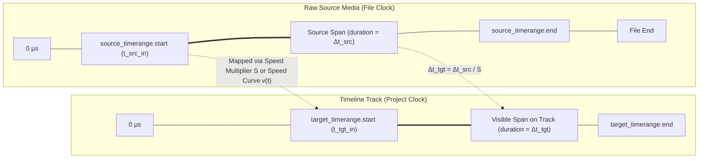
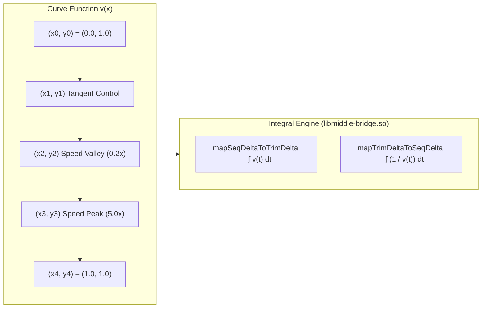
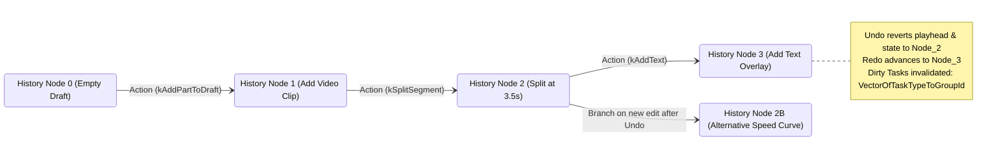

# Blueprint 02: Timeline Engine, Draft Persistence & Non-Destructive Editing Mechanics

**Target Artifact:** `./target-artifacts/capcut.apk`  
**Decompiled Slices:** `./scratch/capcut-decompiled/apktool-out/` (`classes10.dex`, `classes13.dex`, `classes22.dex`, `classes23.dex`, `classes24.dex`, `classes28.dex`, `classes29.dex`, `classes31.dex`, `classes34.dex`)  
**Native Shared Engines:** `libmiddle-bridge.so` (SHA-256 verified), `libclipflow.so`, `libcccreator.so`  
**Investigation Framework:** Static Android Reverse Engineering & REA Static Evidence Contract  

---

## 1. Observed Facts (Static Evidence)

### 1.1 Decompiled Class & Symbol Evidence
All class paths, methods, and JNI bindings cited below were extracted directly from the headless JADX decompilations and parsed ELF dynamic symbol tables:

| Component | Originating File | Class / Struct Descriptor | Native Method / JNI Export Symbol |
| :--- | :--- | :--- | :--- |
| **Project Model** | `classes28.dex` | `com.vega.draft.data.template.Project` | Kotlinx `@Serializable` schema |
| **Track Model** | `classes28.dex` | `com.vega.draft.data.template.track.Track` | Kotlinx `@Serializable` schema |
| **Segment Model** | `classes31.dex` | `com.vega.draft.data.template.track.Segment` | Kotlinx `@Serializable` schema |
| **TimeRange Struct** | `classes31.dex` | `com.vega.draft.data.template.track.Segment$TimeRange` | Fields: `a` (`start: long`), `b` (`duration: long`) |
| **Clip Transform** | `classes31.dex` | `com.vega.draft.data.template.track.Clip` | Fields: `scale`, `rotation`, `transform`, `flip`, `alpha` |
| **Split Command** | `classes13.dex` | `com.vega.middlebridge.swig.SegmentSplitParam` | `Java_com_vega_middlebridge_swig_SegmentSplitParamModuleJNI_SegmentSplitParam_1split_1time_1set` |
| **Split Request** | `classes13.dex` | `com.vega.middlebridge.swig.SplitSegmentReqStruct` | `Java_com_vega_middlebridge_swig_SplitSegmentModuleJNI_SplitSegmentReqStruct_1params_1set` |
| **Trim/Slip Command**| `classes22.dex` | `com.vega.middlebridge.swig.UpdateTimeRangeParam` | `Java_com_vega_middlebridge_swig_UpdateTimeRangeParamModuleJNI_UpdateTimeRangeParam_1clip_1time_1set` |
| **Move/Ripple** | `classes13.dex` | `com.vega.middlebridge.swig.SegmentMoveParam` | `Java_com_vega_middlebridge_swig_SegmentMoveParamModuleJNI_SegmentMoveParam_1target_1start_1time_1set` |
| **Linear Speed** | `classes24.dex` | `com.vega.middlebridge.swig.MediaChangeSpeedParam` | `Java_com_vega_middlebridge_swig_MediaChangeSpeedParamModuleJNI_MediaChangeSpeedParam_1speed_1set` |
| **Curve Speed Utils**| `classes10.dex` | `com.vega.middlebridge.swig.CurveSpeedUtilsModuleJNI`| `CurveSpeedUtils_mapSeqDeltaToTrimDelta`, `CurveSpeedUtils_mapTrimDeltaToSeqDelta`, `CurveSpeedUtils_transferTrimPointXtoSeqPointX` |
| **Magnetic Track** | `classes23.dex` | `com.vega.edit.base.multitrack.MagneticHelper` | Method `a(HorizontallyState, long, long, long, long)` |
| **Undo/Redo DAG** | `classes34.dex` | `com.vega.clipflow.swig.UndoRedoTasksModuleJNI` | `Java_com_vega_clipflow_swig_UndoRedoTasksModuleJNI_UndoRedoTasksReqStruct_1history_1node_1id_1set` |
| **Edit Result** | `classes29.dex` | `com.vega.middlebridge.swig.EditResult` | `history_node_id_get`, `changedNodes_get`, `actionName_get` |
| **Room Database** | `classes26.dex` | `com.vega.ve.db.DraftDatabase_Impl` | Tables: `media_data_trans`, `StableEntity` |

---

## 2. Derived Conclusions (Architectural Specifications)

### 2.1 Project Schema & Persistence Architecture

CapCut separates its persistent state into two tiers:
1. **The Structural Document Model (`draft_json.json`):** A human-readable, self-contained JSON document serialized via Kotlinx Serialization describing the complete multi-track timeline, assets, transitions, and keyframes.
2. **The Caching Database (`DraftDatabase.db` via Room/SQLite):** Stores persistent video frame transcode hashes (`media_data_trans`) and optical flow camera stabilization matrices (`StableEntity`) to eliminate re-computation across application sessions.

#### 2.1.1 Time Precision Standard
Across all DEX classes and native JNI interfaces, **time is strictly represented as a signed 64-bit integer (`int64` / Java `long`) in microseconds ($\mu s$)**:
$$\text{Timebase} = 10^{-6} \text{ seconds} \quad (1\text{ s} = 1,000,000\,\mu s)$$
- Standard frame duration at $30\text{ fps} = 33,333\,\mu s$.
- Standard frame duration at $60\text{ fps} = 16,666\,\mu s$.
- Standard frame duration at $24\text{ fps} = 41,666\,\mu s$.

#### 2.1.2 Time Mapping: `source_timerange` vs. `target_timerange`
In `com.vega.draft.data.template.track.Segment`:
- `source_timerange: TimeRange`:
  - `start` ($t_{src\_in}$): The in-point offset within the raw source media file (e.g. video file on disk).
  - `duration` ($\Delta t_{src}$): The unscaled media duration sliced from the file.
- `target_timerange: TimeRange`:
  - `start` ($t_{tgt\_in}$): The absolute starting timestamp on the project timeline.
  - `duration` ($\Delta t_{tgt}$): The visible duration occupied on the timeline.

Under constant linear speed multiplier $S$ (`speed: float`):
$$\Delta t_{tgt} = \frac{\Delta t_{src}}{S}$$
Any presentation timestamp $t_{timeline} \in [t_{tgt\_in}, \, t_{tgt\_in} + \Delta t_{tgt}]$ projects to source media timestamp $t_{source}$ by:
$$t_{source} = t_{src\_in} + (t_{timeline} - t_{tgt\_in}) \times S$$

---

### 2.2 Mathematical Specifications for Non-Destructive Timeline Operations

#### 2.2.1 The Split Algorithm (Clip Cleaving)
When a clip segment $S_0$ is split at timeline playhead timestamp $t_{split}$ where:
$$t_{tgt\_in} < t_{split} < t_{tgt\_in} + \Delta t_{tgt}$$
The operation decomposes $S_0$ into left child $S_L$ and right child $S_R$ without modifying source media bytes:

1. **Timeline Target Intervals:**
   - **$S_L$:**
     $$t_{tgt\_in}^{(L)} = t_{tgt\_in}$$
     $$\Delta t_{tgt}^{(L)} = t_{split} - t_{tgt\_in}$$
   - **$S_R$:**
     $$t_{tgt\_in}^{(R)} = t_{split}$$
     $$\Delta t_{tgt}^{(R)} = (t_{tgt\_in} + \Delta t_{tgt}) - t_{split}$$

2. **Source Media Intervals (Linear Speed $S$):**
   - Cut delta on timeline: $\delta_{split} = t_{split} - t_{tgt\_in}$.
   - Source delta: $\delta_{src} = \delta_{split} \times S$.
   - **$S_L$:**
     $$t_{src\_in}^{(L)} = t_{src\_in}$$
     $$\Delta t_{src}^{(L)} = \delta_{src}$$
   - **$S_R$:**
     $$t_{src\_in}^{(R)} = t_{src\_in} + \delta_{src}$$
     $$\Delta t_{src}^{(R)} = \Delta t_{src} - \delta_{src}$$

3. **Speed Curve Splitting (Piecewise Bézier Curves):**
   When `CurveSpeedData` is present, the normalized split coordinate $u \in (0, 1)$ is:
   $$u = \frac{t_{split} - t_{tgt\_in}}{\Delta t_{tgt}}$$
   The curve $C(x)$ is partitioned into $[0, u]$ and $[u, 1]$ using **De Casteljau's algorithm**, and each sub-curve is re-normalized to domain $[0.0, 1.0]$:
   - For $S_L$: $x_L = \frac{x}{u}$
   - For $S_R$: $x_R = \frac{x - u}{1.0 - u}$

4. **Attached Keyframe Migration:**
   For any attached keyframe $K_i$ with time offset $t_{K_i}$ relative to $t_{tgt\_in}$:
   - If $t_{K_i} \le t_{split}$: $K_i$ remains attached to $S_L$ with unmodified local time.
   - If $t_{K_i} > t_{split}$: $K_i$ is migrated to $S_R$ with re-indexed local timestamp:
     $$t_{K_i}^{(R)} = t_{K_i} - \Delta t_{tgt}^{(L)}$$
   - If a keyframe existed exactly at $t_{split}$, a twin keyframe is cloned at $t = 0$ on $S_R$ to preserve continuous interpolation across the cut.

---

#### 2.2.2 The Trim & Slip Algorithms

```mermaid
graph TD
    subgraph Trim_In ["Trim In-Point (Dragging Left Handle)"]
        TI1["User drags left handle by +Δt"] --> TI2["target_timerange.start += Δt"]
        TI2 --> TI3["target_timerange.duration -= Δt"]
        TI3 --> TI4["source_timerange.start += Δt * S"]
        TI4 --> TI5["source_timerange.duration -= Δt * S"]
        TI5 --> TI6["Magnetic Ripple: Shift downstream clips by -Δt"]
    end

    subgraph Slip_Edit ["Slip Edit (Sliding Media within Window)"]
        SE1["User slips content by δ"] --> SE2["target_timerange remains FIXED (start & duration unchanged)"]
        SE2 --> SE3["source_timerange.start += δ"]
        SE3 --> SE4["Downstream clips: UNTOUCHED (zero ripple)"]
    end
```

1. **Trim In-Point (Left Handle Drag by $\Delta t$):**
   Executed via `UpdateTimeRangeParam` with `is_handle_end_task = false`:
   $$t_{tgt\_in}' = t_{tgt\_in} + \Delta t$$
   $$\Delta t_{tgt}' = \Delta t_{tgt} - \Delta t$$
   $$t_{src\_in}' = t_{src\_in} + (\Delta t \times S)$$
   $$\Delta t_{src}' = \Delta t_{src} - (\Delta t \times S)$$
   *Constraint:* $t_{src\_in}' \ge 0$ and $\Delta t_{tgt}' \ge \Delta t_{min}$ (CapCut minimum clip duration = $100,000\,\mu s$ / 0.1s).

2. **Trim Out-Point (Right Handle Drag by $\Delta t$):**
   Executed via `UpdateTimeRangeParam` with `is_handle_end_task = true`:
   $$t_{tgt\_in}' = t_{tgt\_in} \quad (\text{unchanged})$$
   $$\Delta t_{tgt}' = \Delta t_{tgt} + \Delta t$$
   $$t_{src\_in}' = t_{src\_in} \quad (\text{unchanged})$$
   $$\Delta t_{src}' = \Delta t_{src} + (\Delta t \times S)$$
   *Constraint:* $t_{src\_in} + \Delta t_{src}' \le \text{MediaFileDuration}$.

3. **Slip Edit:**
   Slips the visible source window without changing the clip's position or duration on the timeline:
   $$t_{tgt\_in}' = t_{tgt\_in}, \quad \Delta t_{tgt}' = \Delta t_{tgt}$$
   $$t_{src\_in}' = t_{src\_in} + \delta_{slip}, \quad \Delta t_{src}' = \Delta t_{src}$$
   *Ripple Effect:* Exactly zero ripple on downstream clips.

---

#### 2.2.3 Magnetic Main Track vs. Free Overlay Tracks

Decompilation of `MagneticHelper.java` and `UpdateTimeRangeParamModuleJNI` exposes the two contrasting track paradigms in CapCut:

| Property | Magnetic Main Track (`track_index = 0`) | Free Overlay Tracks (PIP, Audio, Text) |
| :--- | :--- | :--- |
| **Gaps Allowed** | **Strictly Forbidden (Zero Gaps).** Deleting or trimming automatically ripples all subsequent clips leftward. | **Fully Allowed.** Clips can be freely positioned with arbitrary gaps. |
| **Collision Resolution**| `force_resolve_track_conflicts = true`. Dropping a clip between two clips splits or pushes downstream clips rightward. | Overlapping clips are allowed or automatically pushed to an adjacent sub-layer track lane (`auto_find_target_track`). |
| **Ripple Propagation** | Any duration change $\Delta t$ ripples all clips $C_{k}$ ($k > i$) by offset $\Delta t$. | Trimming an overlay clip affects only that clip; downstream clips remain stationary. |
| **Track Linkage** | Main track acts as the parent timeline spine. Child overlay clips (stickers, subtitles) link to main clip via `AttachInfo`. | Overlay tracks do not anchor other tracks. |

##### The Magnetic Snapping Formula (`MagneticHelper.java`)
When scrubbing a clip or dragging edit handles near cut points or playheads:
1. **Dynamic Snap Distance Threshold ($D_{snap}$ in microseconds):**
   Extracted from decompiled method `MagneticHelper.h()`:
   $$D_{snap} = \frac{100,000}{\frac{1,000,000}{\text{TrackConfig.c}}}$$
   Where $\text{TrackConfig.c}$ is the active timeline zoom scale (pixels per microsecond). This ensures that the physical snapping distance on the touchscreen remains constant (approx. $10\text{–}15\text{ dp}$) regardless of timeline zoom level!
2. **Nearest Snap Point Selection (`MagneticHelper.a`):**
   Given candidate left edge $t_{start}$ and right edge $t_{end}$:
   $$\text{Candidate Snap Points } P = \{ t_{\text{playhead}} \} \cup \{ t_{\text{in}}^{(k)}, \, t_{\text{out}}^{(k)} \mid \forall \text{ segments } k \}$$
   Using binary search `MagneticHelper.d()`, finds nearest $p \in P$:
   $$\text{If } |t_{start} - p| \le D_{snap} \text{ and } |t_{end} - p'| \le D_{snap}:$$
   $$\text{Snap to } \begin{cases} p & \text{if } |t_{start} - p| \le |t_{end} - p'| \\ p' & \text{otherwise} \end{cases}$$

---

#### 2.2.4 Speed Ramping (Variable Bézier Curves)

The C++ speed engine in `libmiddle-bridge.so` (exposed via `CurveSpeedUtilsModuleJNI`) evaluates continuous time remapping using a normalized speed curve $v(x)$ defined over $x \in [0.0, 1.0]$:

1. **Mapping Timeline Delta to Source Delta (`CurveSpeedUtils_mapSeqDeltaToTrimDelta`):**
   The elapsed media time $\Delta t_{source}$ for an elapsed timeline interval $[0, \tau]$ is the integral of the instantaneous speed $v(t)$:
   $$\Delta t_{source}(\tau) = \int_0^\tau v\left(\frac{t}{\Delta t_{tgt}}\right) \, dt$$
2. **Inverse Mapping (`CurveSpeedUtils_mapTrimDeltaToSeqDelta`):**
   Given a source frame at offset $\Delta t_{source}$, the corresponding display timestamp on the timeline $\tau$ is obtained by inverting the integral:
   $$\tau = \Delta t_{source}^{-1}(\Delta t_{source})$$
3. **Average Curve Speed (`CurveSpeedUtils_getAveCurveSpeed`):**
   The effective average playback speed $\bar{v}$ across the entire clip is:
   $$\bar{v} = \frac{\Delta t_{src}}{\Delta t_{tgt}} = \int_0^1 v(x) \, dx$$
4. **Keyframe Coordinate Warping (`CurveSpeedUtils_transferTrimPointXtoSeqPointX`):**
   When speed ramping is applied to a clip that already contains keyframes at source timestamps $t_{src}^{(i)}$, each keyframe's timeline position $t_{tgt}^{(i)}$ is non-linearly warped by evaluating:
   $$t_{tgt}^{(i)} = t_{tgt\_in} + \text{mapTrimDeltaToSeqDelta}(t_{src}^{(i)} - t_{src\_in})$$

---

#### 2.2.5 The Undo/Redo DAG State Machine

Decompilation of `com.vega.clipflow.swig.UndoRedoTasksModuleJNI` and `com.vega.middlebridge.swig.EditResult` confirms that CapCut does not use naive full-project JSON snapshotting for undo/redo (which would cause severe memory churn and stutter on large projects). Instead, it implements a **Directed Acyclic Graph (DAG) of Incremental State Diffs**:

1. **History Node Identity (`history_node_id`):**
   Every mutation operation generates an immutable `history_node_id` (UUID) returned inside `EditResult`.
2. **Selective Entity Invalidation (`changedNodes`):**
   `EditResult.changedNodes_get()` returns a list of exact entity pointers (`VectorNodes`) modified by the action. Only those specific views in the UI layer re-bind, avoiding full-screen timeline re-renders.
3. **Algorithm Task Cache Invalidation (`dirty_task`):**
   When `UndoRedoTasksReqStruct` reverts or advances history state:
   - `action_type = 0` (Undo) or `1` (Redo).
   - `dirty_task` (`VectorOfTaskTypeToGroupId`) lists background tasks that must be purged from the native cache:
     - Optical flow motion vectors (Task Type 1).
     - AI audio beat detection markers (Task Type 2).
     - Smart crop face tracking paths (Task Type 3).
     - Rendered preview frame cache in `libres_pool.so` (Task Type 4).

---

## 3. Unknowns & Runtime Boundaries (`NOT_DETERMINED`)

1. **Piecewise Spline Polynomial Order in `libmiddle-bridge.so` (`NOT_DETERMINED`):**
   - While `GraphPoint` defines tangent handles indicative of cubic Bézier splines ($C^1$ continuity), the exact numerical integration step size (whether evaluated via adaptive Simpson's rule or precomputed 1024-entry lookup table / LUT) inside `CurveSpeedUtils_mapSeqDeltaToTrimDelta` is compiled into native AArch64 machine instructions and cannot be determined from Java JNI method signatures alone.
2. **Maximum History Stack Depth Limit (`NOT_DETERMINED`):**
   - The Java/Kotlin layer imposes no explicit limit on the number of undo steps; the C++ DAG pruning threshold (e.g. maximum memory limit before oldest undo nodes are dropped) is governed internally by native configuration in `libclipflow.so`.
3. **Hardware-Specific Audio Pitch Shift Algorithm (`NOT_DETERMINED`):**
   - `Segment.isToneModify` (pitch preservation during speed ramp) forwards flags to `libaudioeffect.so`. Whether it utilizes a Phase Vocoder or WSOLA (Waveform Similarity Overlap-Add) algorithm is implemented entirely in native DSP code.
