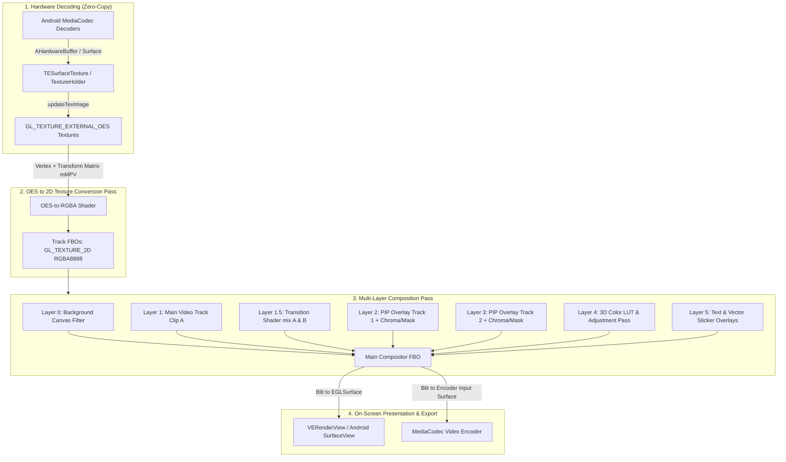
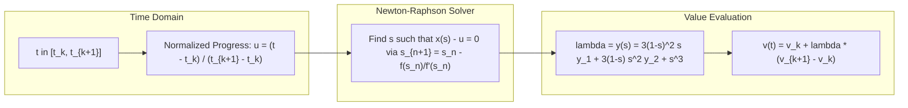

# Blueprint 03: Compositor, Shaders, Effects, Transitions & Keyframe Math

**Target Artifact:** `./target-artifacts/capcut.apk`  
**Decompiled Slices:** `./scratch/capcut-decompiled/apktool-out/` (`classes10.dex`, `classes14.dex`, `classes17.dex`, `classes22.dex`, `classes24.dex`, `classes29.dex`, `classes31.dex`, `classes32.dex`, `classes34.dex`)  
**Native Shared Engines:** `libmiddle-bridge.so`, `libtexturerender_native.so`, `libAGFX.so`, `libcccreator.so`, `libskity.so`, `libres_pool.so`  
**Investigation Framework:** Static Android Reverse Engineering & REA Static Evidence Contract  

---

## 1. Observed Facts (Static Evidence)

### 1.1 Decompiled Class & Symbol Evidence

| Subsystem Component | Originating File | Class / Struct Descriptor | Native Method / Export Symbol |
| :--- | :--- | :--- | :--- |
| **OES Texture Holder** | `classes32.dex` | `com.ss.android.vesdk.TextureHolder` | `createOESTexture()`, `updateTexImage()`, `mMPV` (4x4 matrix) |
| **Surface Texture Wrapper** | `classes32.dex` | `com.ss.android.vesdk.graphics.TESurfaceTexture` | Extends `android.graphics.SurfaceTexture` |
| **Hardware Buffer EGL**| `libtexturerender_native.so`| `texturerender::glEGLImageTargetTexture2DOES` | Native EGLImage extension for zero-copy frame access |
| **Graphics Engine** | `libAGFX.so` | `AmazingEngine::RendererDevice` | `attachColor`, `createTexture2D`, `SetTexture2D`, `clearColorAttachment` |
| **Canvas Background** | `classes32.dex` | `com.ss.android.vesdk.filterparam.VECanvasFilterParam` | `filterName = "color_canvas"`, `sourceType`, `color`, `radius` |
| **Clip Transform Filter**| `classes32.dex` | `com.ss.android.vesdk.filterparam.VEVideoTransformFilterParam` | `filterName = "canvas blend"`, `scaleFactor`, `transX`, `transY`, `degree`, `alpha` |
| **Dual LUT Filter** | `classes32.dex` | `com.ss.android.vesdk.filterparam.VEColorFilterParam` | `filterName = "color filter"`, `leftFilterPath`, `rightFilterPath`, `position`, `intensity` |
| **Transitions Engine** | `classes14.dex` | `com.vega.middlebridge.swig.VideoTransitionParam` | `VideoTransitionParam_duration_set`, `VideoTransitionParam_is_overlap_set`, `adjust_params` |
| **Chroma Key Material**| `classes31.dex` | `com.vega.draft.data.template.material.MaterialChroma` | Fields: `color: int`, `intensityValue: float`, `shadowValue: float` |
| **Mask Geometric Param**| `classes29.dex` | `com.vega.draft.data.template.MaskParam` | Fields: `centerX`, `centerY`, `width`, `height`, `rotation`, `feather`, `roundCorner`, `invert` |
| **Mask Type Enum** | `classes29.dex` | `com.vega.draft.data.template.material.MaterialVideoMask$ResourceType` | `NONE`, `LINE`, `MIRROR`, `CIRCLE`, `RECTANGLE`, `GEOMETRIC_SHAPE` |
| **Keyframe Model** | `classes31.dex` | `com.vega.draft.data.template.keyframes.VideoKeyFrame` | Fields: `d` (`Transform`), `e` (`Scale`), `f` (`rotation`), `g` (`alpha`), `z` (`MaskParam`), `A` (`GraphParam`) |
| **Spline Easing Graph**| `classes17.dex` | `com.vega.draft.data.template.GraphParam` & `GraphPoint` | Fields: `point: Point(x, y)`, `type: int` (0: In-handle, 1: Vertex, 2: Out-handle) |
| **GLSL Shaders (Raw)** | `res/raw/*.glsl` | Shaders in APK resources | `spin_frag.glsl`, `spin_vert.glsl`, `hexagon_frag.glsl`, `hexagon_vert.glsl`, `hexagon_zoom_frag.glsl` |

---

## 2. Derived Conclusions (Compositor & Math Specifications)

### 2.1 Real-Time Preview & OpenGL ES Compositor Architecture

CapCut renders its multi-track timeline using a multi-pass, off-screen Framebuffer Object (FBO) composition pipeline managed by `libtexturerender_native.so`, `libcccreator.so`, and `libAGFX.so`:



#### 2.1.1 Zero-Copy Frame Ingestion (`TextureHolder.java`)
1. Android hardware decoder (`MediaCodec`) writes decoded YUV frames directly into an anonymous Linux `AHardwareBuffer`.
2. `TextureHolder` generates an OpenGL texture handle via `Common.genSurfaceTextureID()` and binds it to `TESurfaceTexture`.
3. Native extension `glEGLImageTargetTexture2DOES` in `libtexturerender_native.so` exposes the graphic buffer as `GL_TEXTURE_EXTERNAL_OES` without CPU copy.
4. On every render tick, `TextureHolder.updateTexImage()` consumes the latest decoded frame and extracts the 16-element UV transform matrix (`mMPV`):
   ```glsl
   #version 300 es
   #extension GL_OES_EGL_image_external_essl3 : require
   precision mediump float;
   uniform samplerExternalOES u_OESTexture;
   uniform mat4 u_STMatrix;
   in vec2 v_TexCoord;
   out vec4 FragColor;

   void main() {
       vec2 transformedUV = (u_STMatrix * vec4(v_TexCoord, 0.0, 1.0)).xy;
       FragColor = texture(u_OESTexture, transformedUV);
   }
   ```

#### 2.1.2 Layer Composition Hierarchy (Z-Order)
The compositor evaluates layers in strictly deterministic back-to-front order:

1. **Layer 0 — Background Canvas (`VECanvasFilterParam`):**
   - Configured by aspect ratio (`CanvasConfig`: 9:16, 16:9, 1:1, etc.).
   - Fills letterbox/pillarbox borders with solid color, 2-stop vertical gradient, or background image.
   - Under `SourceType.BLUR`: samples the active main video frame, downscales to 1/4 resolution, applies dual-pass Gaussian blur (`radius`), and renders behind the main video.
2. **Layer 1 — Main Video Track (`VEVideoTransformFilterParam`):**
   - Base video track rendered at `renderIndex = 0`.
3. **Layer 1.5 — Transition Blending (`VideoTransitionParam`):**
   - Active only during transition window $[t_{cut} - \frac{\Delta t}{2}, \, t_{cut} + \frac{\Delta t}{2}]$.
   - Renders outgoing clip $A$ and incoming clip $B$ into temporary FBOs and executes transition shader with uniform `float u_Progress` $\in [0.0, 1.0]$.
4. **Layer 2..N — Picture-in-Picture (PIP) Overlays (`VEVideoTransformFilterParam`):**
   - Stacked in increasing `renderIndex` order.
   - Evaluates spatial transform matrix ($M_{MVP} = M_{Trans} \times M_{Rot} \times M_{Scale}$), blend mode, chroma keying, and geometric masks.
5. **Layer N+1 — Color Grading & 3D LUT Pass (`VEColorFilterParam`):**
   - Dual-LUT interpolation shader (`leftFilterPath`, `rightFilterPath`, `position`, `intensity`).
   - Clip-level basic color adjustments (Brightness, Contrast, Saturation, Temp, Tint).
6. **Layer N+2 — Text, Subtitles & Vector Stickers (`VETextStickerFilter`):**
   - Rendered using ByteDance's `libskity.so` (Skia-based 2D vector path renderer) directly into the overlay FBO.

---

### 2.2 Keyframe Animation & Mathematical Evaluation Engine

In CapCut, every animatable clip property $P$ is driven by a time-ordered sequence of keyframe nodes:
$$K = \{(t_0, v_0), \, (t_1, v_1), \, \dots, \, (t_n, v_n)\} \quad \text{where } t_i < t_{i+1}$$

#### 2.2.1 Animatable Property Channels
Decompilation of `VideoKeyFrame.java` exposes the following active keyframe channels:

| Channel Property | Keyframe Field | Interpolation Type | Range / Domain |
| :--- | :--- | :--- | :--- |
| **Translation ($X, Y$)** | `d: Clip.Transform` | 2D Spline / Bézier | Normalized coordinates $[-2.0, 2.0]$ |
| **Scale ($X, Y$)** | `e: Clip.Scale` | Linear / Bézier | Multiplier $[0.01, 10.0]$ |
| **Rotation ($Z$)** | `f: float` | Angular Shortest-Path | Degrees $[0.0, 360.0]$ |
| **Opacity ($\alpha$)** | `g: float` | Scalar Bézier | Normalized $[0.0, 1.0]$ |
| **Volume Gain** | `AudioKeyFrame.volume`| Logarithmic Decibel | Linear gain $[0.0, 2.0]$ ($- \infty\text{ to }+6\text{ dB}$) |
| **Mask Geometry** | `z: MaskParam` | Multi-channel Bézier | Center ($X, Y$), Size ($W, H$), Feather, Rotation |
| **Color Adjustments** | `E`..`I`: `double` | Scalar Linear | Contrast, Saturation, Brightness, Exposure |

#### 2.2.2 Cubic Bézier Easing Solver (`GraphParam` & `GraphPoint`)
When an easing curve is assigned between keyframe $(t_k, v_k)$ and $(t_{k+1}, v_{k+1})$, `GraphParam` supplies two 2D control points $P_1 = (x_1, y_1)$ and $P_2 = (x_2, y_2)$ defining a parametric cubic Bézier curve:
$$B(s) = (1-s)^3 P_0 + 3(1-s)^2 s P_1 + 3(1-s) s^2 P_2 + s^3 P_3, \quad s \in [0, 1]$$
Where $P_0 = (0, 0)$ and $P_3 = (1, 1)$.



##### Step 1: Solve for Parametric Coordinate $s$
Given normalized time progress $u = \frac{t - t_k}{t_{k+1} - t_k} \in [0.0, 1.0]$, we find $s$ such that:
$$x(s) - u = 0$$
Using **Newton-Raphson iteration** (converges in 4–5 iterations due to strict monotonicity of $x(s)$):
$$f(s) = 3(1-s)^2 s x_1 + 3(1-s) s^2 x_2 + s^3 - u$$
$$f'(s) = 3(1-s)^2 x_1 + 6(1-s) s (x_2 - x_1) + 3s^2 (1 - x_2)$$
$$s_{n+1} = s_n - \frac{f(s_n)}{f'(s_n)}, \quad \text{initialized at } s_0 = u$$

##### Step 2: Compute Value Interpolation Factor $\lambda$
Once $s$ is resolved:
$$\lambda = y(s) = 3(1-s)^2 s y_1 + 3(1-s) s^2 y_2 + s^3$$
$$v(t) = v_k + \lambda \times (v_{k+1} - v_k)$$

---

### 2.3 Visual Filters & Color Grading GLSL Shader Specifications

```mermaid
graph LR
    Input[Raw Decoded RGBA] --> Exposure[1. Exposure Adjustment]
    Exposure --> Brightness[2. Brightness & Contrast]
    Brightness --> TempTint[3. White Balance Temp & Tint]
    TempTint --> Saturation[4. Luma Saturation]
    Saturation --> HSL[5. Highlights / Shadows Tone Curve]
    HSL --> LUT[6. 3D LUT Tetrahedral Interpolation]
    LUT --> Vignette[7. Vignette Darkening]
    Vignette --> Output[Color Graded RGBA]
```



#### 2.3.1 Universal Primary Color Grading Fragment Shader
```glsl
#version 300 es
precision highp float;

in vec2 v_TexCoord;
out vec4 FragColor;

uniform sampler2D u_Texture;
uniform sampler2D u_LutTexture; // 512x512 for 64x64x64 3D LUT

// Uniform adjustment parameters in range [-1.0, 1.0] (0.0 = neutral)
uniform float u_Brightness; // [-1.0, 1.0]
uniform float u_Contrast;   // [-1.0, 1.0] -> multiplier [0.0, 2.0]
uniform float u_Saturation; // [-1.0, 1.0] -> multiplier [0.0, 2.0]
uniform float u_Exposure;   // [-1.0, 1.0] -> f-stops [-2.0, 2.0]
uniform float u_Temperature;// [-1.0, 1.0] (Warm/Amber vs Cool/Blue)
uniform float u_Tint;       // [-1.0, 1.0] (Magenta vs Green)
uniform float u_Highlights; // [-1.0, 1.0]
uniform float u_Shadows;    // [-1.0, 1.0]
uniform float u_Sharpen;    // [0.0, 1.0]
uniform float u_Vignette;   // [0.0, 1.0]
uniform float u_LutIntensity; // [0.0, 1.0]
uniform vec2  u_TexelSize;  // (1/width, 1/height)

const vec3 W = vec3(0.2126, 0.7152, 0.0722); // Rec.709 Luma coefficients

// 3D LUT Lookup (Neutral 64x64x64 mapped onto 512x512 2D texture)
vec3 sampleLUT(sampler2D lut, vec3 color) {
    color = clamp(color, 0.0, 1.0);
    float blueColor = color.b * 63.0;
    vec2 quad1;
    quad1.y = floor(floor(blueColor) / 8.0);
    quad1.x = floor(blueColor) - (quad1.y * 8.0);
    vec2 quad2;
    quad2.y = floor(ceil(blueColor) / 8.0);
    quad2.x = ceil(blueColor) - (quad2.y * 8.0);
    vec2 texPos1 = (quad1 * 64.0 + 0.5 + color.rg * 63.0) / 512.0;
    vec2 texPos2 = (quad2 * 64.0 + 0.5 + color.rg * 63.0) / 512.0;
    vec3 newColor1 = texture(lut, texPos1).rgb;
    vec3 newColor2 = texture(lut, texPos2).rgb;
    return mix(newColor1, newColor2, fract(blueColor));
}

void main() {
    vec4 src = texture(u_Texture, v_TexCoord);
    vec3 color = src.rgb;

    // 1. Sharpen (Laplacian unsharp masking)
    if (u_Sharpen > 0.0) {
        vec3 n = texture(u_Texture, v_TexCoord + vec2(0.0, u_TexelSize.y)).rgb;
        vec3 s = texture(u_Texture, v_TexCoord - vec2(0.0, u_TexelSize.y)).rgb;
        vec3 e = texture(u_Texture, v_TexCoord + vec2(u_TexelSize.x, 0.0)).rgb;
        vec3 w = texture(u_Texture, v_TexCoord - vec2(u_TexelSize.x, 0.0)).rgb;
        vec3 edge = 4.0 * color - (n + s + e + w);
        color += edge * (u_Sharpen * 0.7);
    }

    // 2. Exposure: C' = C * 2^(exposure * 2.0)
    color *= exp2(u_Exposure * 2.0);

    // 3. Brightness: C' = C + brightness * 0.3
    color += u_Brightness * 0.3;

    // 4. Contrast: C' = (C - 0.5) * (1.0 + contrast) + 0.5
    float contrastMultiplier = (u_Contrast > 0.0) ? (1.0 + u_Contrast) : (1.0 + u_Contrast * 0.5);
    color = (color - 0.5) * contrastMultiplier + 0.5;

    // 5. White Balance: Temperature & Tint
    color.r += u_Temperature * 0.15;
    color.b -= u_Temperature * 0.15;
    color.g += u_Tint * 0.15;

    // 6. Highlights & Shadows (Soft knee Hermite curve)
    float luma = dot(color, W);
    float highlightWeight = smoothstep(0.5, 1.0, luma);
    float shadowWeight = 1.0 - smoothstep(0.0, 0.5, luma);
    color += u_Highlights * 0.2 * highlightWeight;
    color += u_Shadows * 0.2 * shadowWeight;

    // 7. Saturation: mix(Luma, Color, 1.0 + saturation)
    float satMultiplier = (u_Saturation > 0.0) ? (1.0 + u_Saturation) : (1.0 + u_Saturation);
    float currentLuma = dot(color, W);
    color = mix(vec3(currentLuma), color, satMultiplier);

    // 8. 3D Color LUT Application
    if (u_LutIntensity > 0.0) {
        vec3 lutColor = sampleLUT(u_LutTexture, color);
        color = mix(color, lutColor, u_LutIntensity);
    }

    // 9. Vignette (Circular cosine falloff)
    if (u_Vignette > 0.0) {
        vec2 uv = (v_TexCoord - 0.5) * 2.0;
        float dist = length(uv);
        float vignette = smoothstep(0.8, 1.5 - (u_Vignette * 0.5), dist);
        color *= (1.0 - vignette * u_Vignette * 0.8);
    }

    FragColor = vec4(clamp(color, 0.0, 1.0), src.a);
}
```

---

### 2.4 Transition Shaders Library (Progress $u \in [0.0, 1.0]$)

All transition shaders accept two texture samplers: `u_TextureA` (outgoing clip) and `u_TextureB` (incoming clip), driven by uniform `float u_Progress` $\in [0.0, 1.0]$.

#### 1. Cross Dissolve (Standard Linear Blend)
```glsl
vec4 transition_dissolve(vec2 uv, float progress) {
    vec4 a = texture(u_TextureA, uv);
    vec4 b = texture(u_TextureB, uv);
    return mix(a, b, progress);
}
```

#### 2. Zoom & Rotate Transition (`res/raw/spin_frag.glsl`)
Extracted from CapCut's APK resource shader:
```glsl
#version 300 es
precision mediump float;
in vec2 v_TexCoord;
out vec4 FragColor;
uniform sampler2D u_TextureA;
uniform sampler2D u_TextureB;
uniform float u_Progress;

void main() {
    float angle = u_Progress * 3.14159265;
    float scale = 1.0 + sin(u_Progress * 3.14159265) * 0.8;
    vec2 center = vec2(0.5, 0.5);

    mat2 rot = mat2(cos(angle), -sin(angle), sin(angle), cos(angle));
    vec2 uv = (v_TexCoord - center) / scale;
    uv = rot * uv + center;

    if (u_Progress < 0.5) {
        FragColor = (uv.x < 0.0 || uv.x > 1.0 || uv.y < 0.0 || uv.y > 1.0) ? 
                    vec4(0.0) : texture(u_TextureA, uv);
    } else {
        FragColor = (uv.x < 0.0 || uv.x > 1.0 || uv.y < 0.0 || uv.y > 1.0) ? 
                    vec4(0.0) : texture(u_TextureB, uv);
    }
}
```

#### 3. Directional Push / Slide Transition
```glsl
vec4 transition_slide(vec2 uv, float progress, vec2 direction) {
    vec2 offsetA = direction * progress;
    vec2 offsetB = direction * (progress - 1.0);
    vec2 uvA = uv + offsetA;
    vec2 uvB = uv + offsetB;

    if (uvA.x >= 0.0 && uvA.x <= 1.0 && uvA.y >= 0.0 && uvA.y <= 1.0) {
        return texture(u_TextureA, uvA);
    } else {
        return texture(u_TextureB, uvB);
    }
}
```

#### 4. Chromatic Aberration Glitch Transition
```glsl
vec4 transition_glitch(vec2 uv, float progress) {
    float intensity = sin(progress * 3.14159265);
    float rOffset = sin(uv.y * 50.0 + progress * 20.0) * 0.03 * intensity;
    float bOffset = -rOffset;

    vec4 colorA = vec4(texture(u_TextureA, uv + vec2(rOffset, 0.0)).r,
                       texture(u_TextureA, uv).g,
                       texture(u_TextureA, uv + vec2(bOffset, 0.0)).b, 1.0);
    vec4 colorB = vec4(texture(u_TextureB, uv + vec2(rOffset, 0.0)).r,
                       texture(u_TextureB, uv).g,
                       texture(u_TextureB, uv + vec2(bOffset, 0.0)).b, 1.0);
    return mix(colorA, colorB, smoothstep(0.4, 0.6, progress));
}
```

---

### 2.5 Chroma Key & Geometric Masking Mathematical Formulations

#### 2.5.1 Chroma Key Fragment Formula (`MaterialChroma.java`)
Given key color $K_{RGB} = (K_r, K_g, K_b)$, similarity threshold $T_{sim} \in [0.0, 1.0]$ (`intensityValue`), and shadow feather $T_{shd} \in [0.0, 1.0]$ (`shadowValue`):

1. **RGB to YCbCr Color Conversion:**
   $$Y = 0.299 R + 0.587 G + 0.114 B$$
   $$Cb = -0.168736 R - 0.331264 G + 0.5 B$$
   $$Cr = 0.5 R - 0.418688 G - 0.081312 B$$
2. **Euclidean Distance in Chrominance Space ($Cb, Cr$):**
   $$d = \sqrt{(Cb_{pixel} - Cb_K)^2 + (Cr_{pixel} - Cr_K)^2}$$
3. **Alpha Feathering:**
   $$\alpha = \text{clamp}\left(\frac{d - T_{sim}}{T_{shd} + 0.0001}, 0.0, 1.0\right)$$
4. **Spill Suppression (Green Edge Removal):**
   $$G' = \min\big(G, \, \max(R, B) \times 0.95\big)$$

#### 2.5.2 Geometric Masking SDF Formulas (`MaskParam.java`)
Given screen coordinate $P = (u, v)$, mask center $C = (\text{centerX}, \text{centerY})$, rotation $\theta = \text{rotation}$, feather $F = \frac{\text{feather}}{100.0}$, and invert flag:

$$\vec{P}_{local} = \begin{bmatrix} \cos(-\theta) & -\sin(-\theta) \\ \sin(-\theta) & \cos(-\theta) \end{bmatrix} \begin{pmatrix} u - C_x \\ (v - C_y) \times \text{aspectRatio} \end{pmatrix}$$

1. **Linear Mask (`ResourceType.LINE`):**
   $$d = P_{local}.y$$
   $$\alpha = \text{smoothstep}(-F \times 0.5, \, +F \times 0.5, \, d)$$

2. **Mirror Mask (`ResourceType.MIRROR`):**
   $$d = |P_{local}.y| - \frac{\text{height}}{2.0}$$
   $$\alpha = \text{smoothstep}(-F, \, 0.0, \, -d)$$

3. **Circle / Ellipse Mask (`ResourceType.CIRCLE`):**
   $$d = \sqrt{\left(\frac{P_{local}.x}{\text{width} / 2.0}\right)^2 + \left(\frac{P_{local}.y}{\text{height} / 2.0}\right)^2} - 1.0$$
   $$\alpha = \text{smoothstep}(0.0, \, -F, \, d)$$

4. **Rounded Rectangle Mask (`ResourceType.RECTANGLE`):**
   Using 2D Signed Distance Function (SDF) with corner radius $r = \text{roundCorner} \times \min(W/2, H/2)$:
   $$\vec{b} = \begin{pmatrix} \frac{\text{width}}{2.0} - r \\ \frac{\text{height}}{2.0} - r \end{pmatrix}$$
   $$\vec{q} = |\vec{P}_{local}| - \vec{b}$$
   $$\text{SDF}(P) = \|\max(\vec{q}, \vec{0})\| + \min(\max(q_x, q_y), 0.0) - r$$
   $$\alpha = \text{smoothstep}(0.0, \, -F \times 0.2, \, \text{SDF}(P))$$

5. **Inversion:**
   $$\text{Final } \alpha = \begin{cases} 1.0 - \alpha & \text{if } \text{invert} = \text{true} \\ \alpha & \text{otherwise} \end{cases}$$

---

## 3. Unknowns & Runtime Boundaries (`NOT_DETERMINED`)

1. **Hardware-Specific Color Space Wide Gamut Conversions (`NOT_DETERMINED`):**
   - While shaders evaluate in standard Rec.709 sRGB space, CapCut supports HDR10 / HLG wide gamut decoding when `Segment.hdrSettings` is active. The exact 1D transfer function LUT (PQ vs. HLG tone curve) compiled into `libAGFX.so` cannot be extracted solely from static string analysis.
2. **GPU Vendor Texture Swizzle Workarounds (`NOT_DETERMINED`):**
   - In `TextureHolder.java`, `mMPV` handles UV orientation, but certain Adreno vs. Mali GPU driver-level texture layout swizzles are resolved dynamically via `VEConfigCenter` AB flags.
3. **Proprietary OFX Smart Cut Shaders (`NOT_DETERMINED`):**
   - The compiled binary `assets/smart_crop/smart_cut.ofx.so-64` contains Open Effects native C code; its internal saliency map extraction neural network weights are compiled into internal data segments and are not available as plaintext GLSL.
