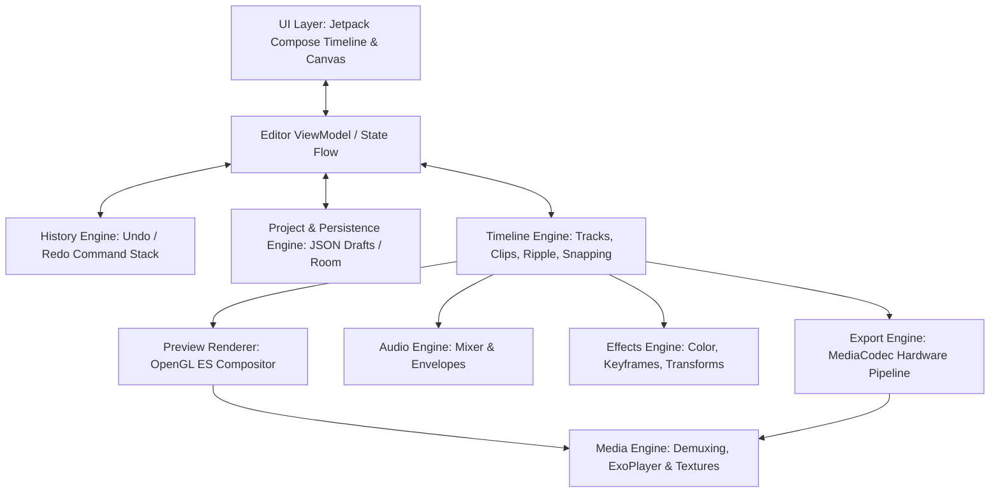

# Independent Video Editor Architecture Specification

**Architecture Name:** NovaCut Architecture  
**Target Platform:** Android (minSdk 24, targetSdk 35/36)  
**Implementation Language:** Kotlin / Java  
**Core Technologies:** Jetpack Compose, Android Media3 / ExoPlayer, MediaCodec, MediaMuxer, OpenGL ES 3.0, Room / JSON Serialization.

---

## 1. Architectural System Overview

The application follows Clean Architecture and Unidirectional Data Flow (UDF / MVI) principles, separating pure domain models from platform-specific hardware decoders and rendering surfaces.

---

## 2. Detailed Module Specifications

### Module 1: Project Engine (`app.engine.project`)
- **Responsibilities:**
  - Manages root project state (`ProjectDocument`), schema versioning, canvas configuration (aspect ratio, resolution, canvas background), and media asset registry (`MediaAsset`).
  - Ensures asset URIs, duration metadata, and display dimensions are validated upon project load.

### Module 2: Timeline Engine (`app.engine.timeline`)
- **Responsibilities:**
  - Coordinates multitrack clip placement (`Track`, `TrackType`, `ClipSegment`).
  - Implements the **Magnetic Main Track** (automatic gap prevention and ripple editing) and independent overlay tracks.
  - Implements split operations, head/tail trimming, clip reordering, and magnetic snapping calculations.
  - Maintains time in integer microseconds (`1 sec = 1,000,000 us`) to prevent floating-point drift.

### Module 3: Media Engine (`app.engine.media`)
- **Responsibilities:**
  - Media extraction, container demuxing, thumbnail generation, and metadata retrieval (duration, dimensions, frame rate, audio channel count).
  - Handles SurfaceTexture decoding via hardware `MediaCodec` and Android Media3 playback wrappers.

### Module 4: Preview Renderer (`app.engine.preview`)
- **Responsibilities:**
  - Composites multiple video, image, text, and sticker layers in real-time onto an OpenGL ES 3.0 texture.
  - Applies transform matrices (Translation, Scale, Rotation, Flip) and layer blend modes (Normal, Multiply, Screen, Overlay).

### Module 5: Audio Engine (`app.engine.audio`)
- **Responsibilities:**
  - Multichannel audio mixing for BGM, video audio, and voiceovers.
  - Evaluates volume gain curves, fade-in/fade-out ramps, and mute states.
  - Generates waveform peak data arrays for timeline visualization.

### Module 6: Effects Engine (`app.engine.effects`)
- **Responsibilities:**
  - Implements real-time image filtering and color adjustments (Brightness, Contrast, Saturation, Temperature, Vignette).
  - Interpolates keyframe properties (linear, ease-in, ease-out, cubic Bezier) for any animated parameter at the current playhead timestamp.

### Module 7: Export Engine (`app.engine.export`)
- **Responsibilities:**
  - Offline video composition pipeline: decodes source frames sequentially, applies timeline transforms and shaders via OpenGL FBO (Frame Buffer Object), encodes frames using hardware `MediaCodec` (H.264/H.265), mixes audio via `MediaMuxer`, and emits progress callbacks (0.0 to 1.0).

### Module 8: History Engine (`app.engine.history`)
- **Responsibilities:**
  - Implements the Command Pattern (`EditorCommand`) with full bidirectional undo and redo capabilities.
  - Stack-based state preservation with memory-efficient delta snapshots.

### Module 9: Persistence Engine (`app.engine.persistence`)
- **Responsibilities:**
  - Continuous autosave to disk (`draft_content.json`).
  - Atomic file writes using temporary swap files to prevent draft corruption during abrupt termination or low-memory kills.

### Module 10: UI Layer (`app.ui`)
- **Responsibilities:**
  - Modern, responsive mobile editing interface built with Jetpack Compose.
  - Sub-components: Top Navigation Bar (Undo/Redo, Export), Canvas Preview Surface, Timecode & Playhead Display, Multitrack Timeline Scrubber, and Contextual Editing Toolbars.
